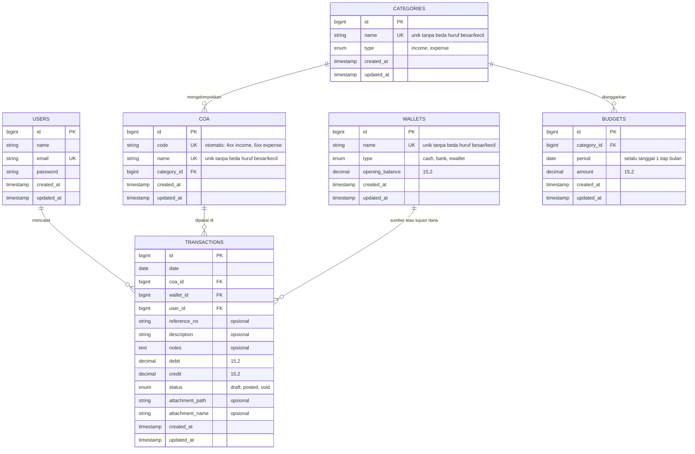

# FinanceApp - Aplikasi Pengelolaan Keuangan

Aplikasi pengelolaan keuangan berbasis **Chart of Account (COA)**. Pengguna mencatat
transaksi, mengelompokkannya ke kategori income dan expense, memantau saldo rekening
dan anggaran, serta mendapatkan laporan **Profit/Loss** (tahunan dan bulanan) yang dapat
diunduh ke Excel.

Dibuat sebagai mini proyek skill test dengan **Laravel** (REST API), **Vue.js** (SPA),
dan **PostgreSQL**.

## Daftar Isi

- [Fitur](#fitur)
- [Teknologi](#teknologi)
- [Struktur Repository](#struktur-repository)
- [Menjalankan Proyek](#menjalankan-proyek)
- [Akun dan Data Demo](#akun-dan-data-demo)
- [Entity Relationship Diagram](#entity-relationship-diagram)
- [Aturan Bisnis](#aturan-bisnis)
- [Ringkasan Endpoint API](#ringkasan-endpoint-api)
- [Keputusan Desain](#keputusan-desain)
- [Keterbatasan dan Pengembangan Lanjutan](#keterbatasan-dan-pengembangan-lanjutan)

## Fitur

**Inti (sesuai soal)**

- CRUD **Kategori** (income / expense), **COA**, dan **Transaksi**
- **Laporan Profit/Loss**: tabel 12 bulan per kategori dengan Total Income, Total Expense,
  dan Net Income
- **Export Excel** laporan Profit/Loss dengan tata letak siap cetak

**Fitur tambahan**

- **Autentikasi** token (Laravel Sanctum), seluruh API dilindungi, batas percobaan login
- **Dashboard** tahunan dan bulanan: ringkasan, perbandingan dengan periode sebelumnya,
  grafik (bulanan atau harian), komposisi pengeluaran, transaksi terbaru, saldo kas dan bank
- **Rekening dan Dompet** (tunai, bank, e-wallet) dengan saldo awal dan saldo berjalan
- **Status transaksi** (draft, posted, void): hanya transaksi posted yang dihitung
- **Lampiran** bukti transaksi (JPG, PNG, PDF) dengan unggah seret-dan-lepas
- Nomor referensi, catatan, filter tanggal, pencarian, dan paginasi transaksi
- **Anggaran** per kategori expense per bulan, dibandingkan dengan realisasi
- **Kode COA otomatis** per tipe (4xx income, 6xx expense)
- Laporan **bulanan** dengan rincian per COA dan perbandingan bulan sebelumnya
- Validasi nama unik tanpa membedakan huruf besar/kecil
- Tanggal dan periode masa depan tidak dapat dipilih
- **Landing page** responsif dengan animasi, **dark mode**, sidebar yang dapat disembunyikan

## Teknologi

| Bagian | Teknologi |
|---|---|
| Backend | PHP 8.3, Laravel 12, Laravel Sanctum, maatwebsite/excel |
| Frontend | Vue 3 (JavaScript), Vite, Pinia, Vue Router, Tailwind CSS v4, Axios, ApexCharts, lucide-vue-next |
| Database | PostgreSQL 16 |
| Font dan gaya | Urbanist, tampilan minimalis dengan dark mode |

## Struktur Repository

```
finance-management-app/
├── backend/     Laravel (REST API)    -> lihat backend/README.md
├── frontend/    Vue 3 (SPA)           -> lihat frontend/README.md
├── docs/        ERD dan analisis masalah
└── README.md
```

Frontend dan backend dipisah (SPA + REST API) dalam satu repository.

## Menjalankan Proyek

### Prasyarat

- PHP 8.2+ dengan ekstensi `pdo_pgsql`, `gd`, `zip`, `fileinfo`, `mbstring`
- Composer
- Node.js 20.19+ atau 22.12+
- PostgreSQL 13+

### 1. Backend

```bash
cd backend
composer install
cp .env.example .env        # Windows CMD: copy .env.example .env
php artisan key:generate
```

Buat database kosong bernama `finance_app` di PostgreSQL, lalu isi `DB_USERNAME` dan
`DB_PASSWORD` di `backend/.env`. Kemudian:

```bash
php artisan migrate:fresh --seed
php artisan serve
```

API berjalan di `http://127.0.0.1:8000`.

### 2. Frontend

Di terminal lain:

```bash
cd frontend
npm install
cp .env.example .env        # Windows CMD: copy .env.example .env
npm run dev
```

Aplikasi berjalan di `http://localhost:5173`.

## Akun dan Data Demo

| Email | Password |
|---|---|
| `admin@example.com` | `password` |

Halaman login menyediakan tombol **Gunakan akun demo** untuk mengisi form otomatis.

Seeder mengisi data contoh untuk **tahun berjalan** (dari Januari sampai bulan ini,
tanggal yang belum tiba dilewati):

- 5 kategori dan 8 COA sesuai contoh pada soal
- 3 rekening: Kas Tunai, Rekening Bank, E-Wallet
- Transaksi bulanan (gaji, profit trading, sekolah, belanja, bensin, parkir, makan siang)
- Satu transaksi **draft** dan satu transaksi **void** sebagai contoh status
- Anggaran bulanan untuk kategori expense

Pengecekan cepat: laporan **Januari** tahun berjalan menghasilkan Total Income
17.500.000, Total Expense 6.795.000, dan Net Income 10.705.000.

## Entity Relationship Diagram



Constraint di database:

- `transactions`: CHECK `(debit > 0 AND credit = 0) OR (credit > 0 AND debit = 0)`
- `budgets`: unique (`category_id`, `period`) dan CHECK `amount > 0`
- `categories`, `coa`, `wallets`: unique index pada `LOWER(name)`
- Foreign key memakai `ON DELETE RESTRICT`

## Aturan Bisnis

**Perhitungan**

- Income = credit - debit, Expense = debit - credit
- Net Income = Total Income - Total Expense
- Saldo rekening = saldo awal + (credit - debit) transaksi posted
- Nominal disimpan sebagai `decimal(15,2)`

**Transaksi**

- Satu transaksi hanya mengisi debit **atau** credit, nilainya lebih dari 0
- COA income hanya memakai credit, COA expense hanya memakai debit
- Transaksi baru selalu berstatus **draft**. Hanya transaksi **posted** yang dihitung di
  laporan, dashboard, anggaran, dan saldo rekening
- Draft boleh diubah dan dihapus. Posted boleh diubah tetapi **tidak boleh dihapus**,
  hanya dibatalkan (void). Void bersifat permanen sebagai jejak audit
- Tanggal transaksi tidak boleh melebihi hari ini
- Lampiran: JPG, PNG, atau PDF, maksimal 2 MB, disimpan di penyimpanan privat

**Master data**

- Nama kategori, COA, dan rekening unik tanpa membedakan huruf besar/kecil
- Kode COA dibuat sistem (kode terbesar pada tipe yang sama + 1) dan tidak dapat diubah.
  Celah akibat penghapusan sengaja tidak diisi ulang
- Tipe kategori tidak dapat diubah jika sudah memiliki COA. COA hanya dapat berpindah ke
  kategori bertipe sama
- Kategori yang memiliki COA, COA yang dipakai transaksi, dan rekening yang dipakai
  transaksi tidak dapat dihapus
- Anggaran hanya untuk kategori expense, satu anggaran per kategori per bulan

**Periode**

- Laporan, dashboard, dan anggaran hanya dapat dilihat sampai periode berjalan
- Batas awal pemilih periode mengikuti data paling awal yang ada

## Ringkasan Endpoint API

Semua endpoint selain login memerlukan header `Authorization: Bearer <token>`.
Detail parameter ada di [backend/README.md](backend/README.md).

| Area | Endpoint |
|---|---|
| Auth | `POST /api/login`, `POST /api/logout`, `GET /api/me` |
| Kategori | `/api/categories` (CRUD) |
| COA | `/api/coa` (CRUD), `GET /api/coa/next-code` |
| Rekening | `/api/wallets` (CRUD, dengan saldo) |
| Transaksi | `/api/transactions` (CRUD), `POST /{id}/post`, `POST /{id}/void`, `/{id}/attachment` |
| Anggaran | `GET/POST /api/budgets`, `DELETE /api/budgets/{id}` |
| Laporan | `GET /api/reports/profit-loss`, `/monthly`, `/export` |
| Dashboard | `GET /api/dashboard` |
| Lainnya | `GET /api/period-range` |

## Keputusan Desain

- **Satu service untuk semua angka.** `ProfitLossService` dipakai laporan, export Excel,
  dan dashboard, sehingga angkanya selalu konsisten. Agregasi dilakukan di PostgreSQL,
  bukan di PHP.
- **Aturan penting dijaga berlapis:** validasi Laravel, CHECK constraint, unique index,
  dan foreign key `RESTRICT`.
- **Status sebagai alur kerja**, bukan isian form. Transaksi yang sudah diposting tidak
  dihapus tetapi dibatalkan, supaya riwayat dan keakuratan laporan terjaga.
- **Net Income dan saldo adalah dua hal berbeda.** Net Income adalah selisih income dan
  expense pada periode terpilih. Saldo Kas dan Bank berasal dari saldo awal rekening
  ditambah seluruh transaksi posted.
- **Token Bearer** dipilih daripada cookie SPA agar frontend dan backend benar-benar
  terpisah.
- **Migrasi diedit langsung** selama tahap pengembangan (dijalankan dengan
  `migrate:fresh`). Setelah aplikasi dipakai di luar lokal, perubahan skema memakai
  migrasi baru.

## Keterbatasan dan Pengembangan Lanjutan

- Belum ada pengujian otomatis
- Belum ada role dan permission, serta riwayat aktivitas pengguna
- Token tidak memiliki masa kedaluwarsa (dapat diatur di `config/sanctum.php`)
- Belum ada soft delete dan penutupan periode, sehingga transaksi posted yang diubah
  dapat mengubah angka periode lampau
- Export Excel hanya tersedia untuk laporan tahunan, dan export PDF belum ada
- Belum ada transaksi terjadwal atau berulang
- Lampiran disimpan di disk lokal server (belum memakai penyimpanan objek)
- Belum ada dukungan multi mata uang

## Tangkapan Layar

Letakkan gambar di `docs/screenshots/` lalu sisipkan di sini:

```markdown


```